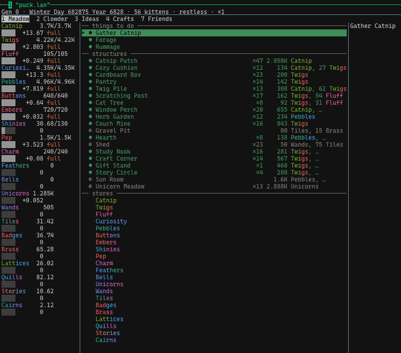
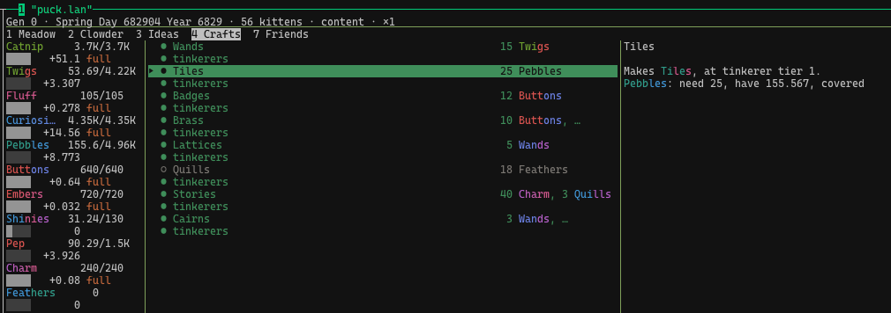

# Clowder

A cozy terminal incremental game about raising a thriving clowder of kittens. Clowder is written in Rust with [ratatui](https://ratatui.rs). You can play it entirely from the keyboard, and it is built to live in a tmux pane for weeks. Nothing in Clowder ever dies, and nothing is ever sacrificed.





Clowder is also a demonstration of [Linked-Intent Development](https://github.com/jszmajda/lid) (LID). Claude Code agents wrote the design, the requirements, the tests and the code. Jess Szmajda, who owns the project, steered it in about 1,340 words over 15 weeks, and she plays the game without reading its design. [How Clowder was built](docs/how-it-was-built.md) measures how much direction that took and where it went.

## Playing

You need Rust 1.89 or newer and a terminal with 24-bit color.

```sh
git clone https://github.com/jszmajda/clowder
cd clowder
cargo run --release
```

To install the `clowder` binary instead, run `cargo install --path crates/clowder-tui`.

- `?` lists every key and explains the symbols on screen.
- `q` saves and quits. `Ctrl-C` also saves first.
- Every key coexists with tmux's defaults. The game uses plain keys, Tab, Enter, Esc, Space, Backspace and the arrow keys, and no Ctrl or Alt chords beyond `Ctrl-C`.
- The mouse moves the cursor and scrolls lists, but it never triggers an action, so a click that focuses the pane is harmless.
- You can close the game whenever you like. On reopening, it catches up on the time you were away.
- Your save lives in your platform's data directory: `~/Library/Application Support/clowder/` on macOS, and `~/.local/share/clowder/` on Linux.

The theme needs truecolor. Inside tmux, you may have to tell tmux that your terminal supports it, for example with `set -as terminal-features ',*:RGB'` in `~/.tmux.conf` (tmux 3.2 or later).

**Spoiler warning.** Everything under `docs/intent/` and `crates/` describes the game's content in detail. If you'd rather discover it by playing, play first.

## Reading the arrow

LID keeps a single chain of intent, the *arrow*: high-level design → component designs → EARS requirements → tests → code. Each step is written before the next and cites it.

| Path | What's there |
|---|---|
| [`docs/high-level-design.md`](docs/high-level-design.md) | The high-level design: vision, architecture and the tenets that settle close calls |
| [`docs/intent/`](docs/intent/) | The design tree: one folder per component, each holding a `{node}-design.md` and a `{node}-specs.md` of EARS requirements |
| [`crates/clowder-core/`](crates/clowder-core/) | The deterministic, headless simulation: game rules, content tables, save and load. It never touches the terminal. |
| [`crates/clowder-tui/`](crates/clowder-tui/) | The ratatui shell: screens, input and theme. Builds the `clowder` binary. |
| [`docs/arrows/`](docs/arrows/) | The arrow overlay: each segment's implementation and audit state, plus [audit records](docs/arrows/_experiments/) |
| [`AGENTS.md`](AGENTS.md) | The instructions every agent works under, including the spoiler policy (`CLAUDE.md` is a symlink to it) |

Requirement IDs follow the design tree's path, and code and tests cite them in `// @spec` comments. `grep -rn TUI-NAV` therefore gathers the navigation component's requirements, the tests that verify them and the code that implements them.

```sh
cargo test                                              # everything
cargo test -p clowder-core                              # game rules only, no terminal needed
cargo test -p clowder-core --test integration <file>::  # one test file's tests
python3 scripts/spec-test-coverage.py                   # every implemented requirement has a test citing it
```

Each crate's integration tests build into one binary, `tests/integration/main.rs`, so its tests run in parallel and the suite links once. A new test file goes in that directory as a module.

## Developing on macOS

Two machine-level problems can each make every first launch of a newly built test binary stall for 30–70 seconds. Nothing fails; a full test run just takes an hour instead of minutes. `python3 scripts/launch-check.py` relinks a test binary, launches it, and reports which problem is present.

- **macOS scans new executables before they run.** Exempt the app your shell runs under: in *System Settings → Privacy & Security → Developer Tools*, add it and switch it on. For a local shell that is your terminal app. For SSH sessions it is `/usr/libexec/sshd-keygen-wrapper` (press ⇧⌘G in the file picker to type the path). If the Developer Tools pane is missing, `sudo spctl developer-mode enable-terminal` makes it appear.
- **`target/` grows until launches stall.** Cargo never deletes superseded build output, and on macOS a debug build keeps its debug information in its object files, so `target/` collects them by the hundred thousand. `cargo clean` clears it, and the workspace rebuilds from scratch in about 15 seconds. Run it after each Rust toolchain update, and whenever the check reports a stall.

## Contributing

Contributions go through LID, just as the agents' changes do. The order is fixed: design, then requirements, then tests, then code, with `@spec` annotations linking each step to the one before. A bug fix follows the same path: find where behavior left the intent and fix the intent there first.

A pull request needs to carry the matching design, requirement and test changes alongside its code. The LID plugins for Claude Code are in the [LID repository](https://github.com/jszmajda/lid):

```
/plugin marketplace add jszmajda/lid
/plugin install linked-intent-dev@jszmajda-lid
/plugin install arrow-maintenance@jszmajda-lid
```

Then start from [`AGENTS.md`](AGENTS.md).

## Credits

Clowder is loosely inspired by [Kittens Game](https://kittensgame.com) by bloodrizer and contributors. It takes inspiration from that game but is not a port: names, numbers and systems diverge freely, and it contains no Kittens Game code.

## License

[MIT](LICENSE)
