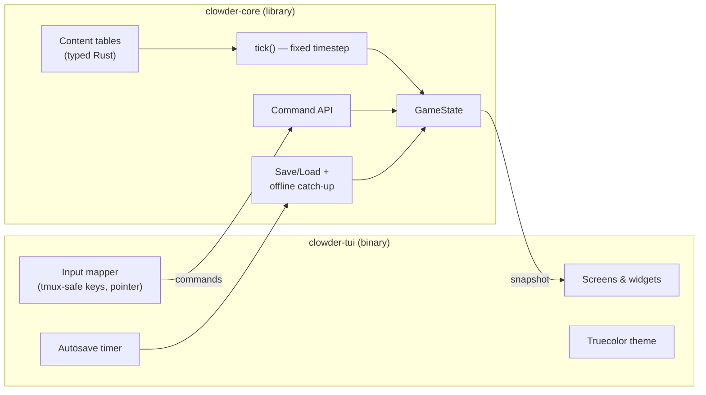

# High-Level Design: Clowder

## Problem

Incremental games are good company for people who live in a terminal: they reward patience, run for weeks, and want to be glanced at between tasks rather than stared at. But the genre's classics are browser-native — they demand a browser tab, a mouse, and a context switch away from the terminal where the player already spends the day. And the genre's high-water mark for depth, Kittens Game, undercuts its own cuteness: kittens starve to death, unicorns are sacrificed, corruption spreads.

There is no terminal-native incremental game with Kittens-Game-scale depth and a genuinely warm heart. Clowder is that game: a Rust + ratatui incremental that lives in a tmux pane, is fully playable from the keyboard, and is about raising a thriving clowder of kittens — where nothing ever dies and nothing is ever sacrificed.

## Approach

Three load-bearing pieces:

### A cozy reinterpretation of the incremental formula

The skeleton is familiar from Kittens Game: gather a base resource (catnip), build structures, attract kittens, assign them jobs, research upgrades, unlock progressively deeper systems, and eventually prestige. Clowder borrows the skeleton, not the content or balance — every mechanic that is punishing or dark in the inspiration is redesigned as playful. Illustrative mappings (the full content taxonomy lives in the component LLDs):

| Grim original | Clowder's version |
|---|---|
| Kittens starve when food runs out | Kittens get **grumpy** and nap through their shifts; a few may wander to the neighbor's yard until the pantry refills — they always come back |
| Sacrificing unicorns for tears | **Unicorn Parades**: unicorns march off in glittering procession and send back rainbows and stardust |
| Faith, worship, and religious orders | **Sunbeam Ceremonies**: kittens gather solemnly in sunpuddles; their devotion accrues Warmth |
| Hunting expeditions | **Pouncing expeditions**: hunting the Red Dot, chasing leaves, raiding the yarn basket |
| Reset/apocalypse-flavored prestige | **The Great Meadow Move**: the clowder relocates to a bigger meadow; the elders' wisdom carries over |

Setbacks in Clowder are always *moods, absences, or slowdowns* — never deaths, losses, or resets of things the player loves.

### A deterministic sim core with a thin TUI shell

A Cargo workspace with two crates:

- **`clowder-core`** — a pure, headless simulation library. Owns the game state, the content tables, a deterministic fixed-timestep `tick()`, the command API (build, assign, research, …), and save/load including offline catch-up. Never touches the terminal.
- **`clowder-tui`** — the ratatui binary. Owns terminal lifecycle, input mapping, screens and widgets, the truecolor theme, and the autosave timer. Translates keys into core commands and renders state snapshots. Contains no game rules.

All game-balance and progression logic is testable headless, without a terminal, at unit-test speed.

### Idle-respect as a design invariant

Time away is first-class play. Offline progress is computed by the same `tick()` function that drives live play — the game fast-forwards through the elapsed ticks on load, so there is one simulation and no shadow math. Nothing accrues *worse* while away than it would have accrued attended (active play adds opportunities, never obligations).

The player may adjust a **game-speed multiplier** (default 1× — a deliberately slow, months-long burn). Speed is part of the saved game state and applies identically to attended and away time: turning the speed up never makes sitting at the terminal better than walking away, so the knob cannot break the invariant.

## Target Users

People who live in a terminal — developers who keep a tmux session running for days and want one pane that is quietly alive. They glance at the game between compiles, press a few keys, and go back to work. The primary user is the author; the design still assumes a fresh player can sit down cold.

## Goals

1. **Ten minutes to the first kitten.** A new player reaches their first kitten within ten minutes without reading documentation.
2. **Headless sim.** The full game-rules test suite runs without a terminal via `cargo test -p clowder-core`.
3. **Absence-proof.** A save can be closed for a week and reopened with nothing lost: the sim ran exactly the rules it would have run attended, so absence is never worse than presence. Hard times show up as moods and absences that reverse on feeding, never as losses.
4. **tmux-native.** The game is fully playable inside a stock tmux session using only keys tmux does not intercept.
5. **Kittens-Game-scale depth.** Interlocking systems — crafting chains, a deep research tree, jobs and skills, ceremonies, expeditions, trade with neighbor colonies, a prestige loop with a permanent unlock shop, and a cosmic late-game arc — keep unlocking across months of casual play, with each subsystem feeding multipliers into the others rather than standing alone.

## Non-Goals

- **No acting by mouse.** The keyboard is the complete interface, and nothing ever needs the mouse. The mouse only moves around: a click puts the cursor on a tab or a row, and the wheel scrolls. A click never acts, because tmux passes the click that focuses a pane on to the program inside it.
- **No multiplayer, server, accounts, or telemetry.** The game is a local, single-player artifact.
- **No second frontend.** `clowder-core` stays frontend-agnostic on principle, but this project ships exactly one UI: the TUI.
- **No mod or plugin system.** Content is compiled in.
- **No low-color fallback.** The theme assumes 24-bit truecolor; degraded palettes for 256-color terminals are out of scope.
- **No fidelity to Kittens Game.** It is inspiration, not a port — names, numbers, and systems diverge freely.

## Tenets

Ordered: when two conflict, the higher one wins.

1. **Cozy over grim.** When a mechanic needs teeth, reach for moods, absences, and slowdowns — never death, sacrifice, or destruction of something the player loves. (The defensible opposite — real stakes and permanent loss — is a fine game; it is not this game.)
2. **Idle-respecting.** When a design choice trades away-time against attended-time, favor the player who walked away. Absence is never punished; active play is a bonus, not an obligation.
3. **Whimsy with clarity.** Flavor names win the label, but the plain mechanical truth is always one keypress away. A player should never lose a decision because a name was cute.
4. **Kittens are the flavour.** Wherever a surface can show a kitten's personality or a bit of kitten fun, it does: kittens doing their own things, saying their own things, each one unlike the last. (The defensible opposite — a spare ledger where kittens are only a theme — is a fine game; it is not this game.)

## System Design

Major components, each a candidate leaf LLD in `docs/intent/` as work reaches it:

- **Simulation** (`clowder-core`): a sub-HLD (`docs/intent/sim/`) whose leaves cover the material economy (resources, structures, crafting, energy), kitten society (population, jobs, skills, moods), the research tree, ceremonies, the mystic economy, trade with neighbor colonies, expeditions, prestige, adventures, and the cosmic and dreamtime late-game arcs. All systems feed one deterministic tick pipeline and one typed effect-resolution stack.
- **Persistence** (`clowder-core`): versioned save format with forward migrations, save location, offline catch-up on load.
- **TUI shell** (`clowder-tui`): screen layout and navigation, input mapping, theme, render/tick loop, autosave cadence, speed control surface.

## Key Design Decisions

1. **Sim core + TUI shell, not a monolith.** Alternatives: a single-crate loop (fastest to first playable, but game rules only testable through the terminal loop) and an async task/channel architecture (flexible timers, but heavy machinery and harder determinism for a sequential sim). The split keeps every game rule headless-testable and makes offline catch-up fall out of determinism.
2. **Fixed-timestep deterministic ticks; wall-clock only at the boundary.** The sim advances in discrete ticks; the shell decides when ticks happen. Offline progress replays ticks through the same code path rather than a separate estimator, so live and away play can never disagree. Alternative — closed-form catch-up formulas — rejected as shadow math that drifts from the real rules.
3. **Content as typed Rust tables.** Buildings, jobs, upgrades, and resources are `const`/`static` structures in `clowder-core`. Alternative — RON/TOML data files — buys mod-ability and no-recompile tweaking at the cost of a loader, schema validation, and losing compiler-checked refactors. With no mod system planned (non-goal), the type checker wins.
4. **Truecolor-only theme.** The palette is designed once, in 24-bit color, for terminals that support it. Alternative — adaptive 256-color fallback — doubles the design and test surface for terminals the target user doesn't use.
5. **tmux-first keyboard model.** All bindings are plain printable keys, Tab, and arrows. No Ctrl chords (Ctrl-B is the tmux prefix; other Ctrl keys collide with terminal conventions — only Ctrl-C is honored, as emergency quit), no Alt/Meta (ambiguous Esc-prefix encoding under tmux `escape-time`), no function keys (terminfo variance). Single-key mnemonics per screen, with a persistent hint bar so bindings are discoverable without a manual. The mouse uses the left button and the wheel only — no drags, no modifier-clicks, no right or middle button — leaving those to tmux and the terminal.
6. **Human-readable versioned saves.** Saves serialize via serde to a human-readable format carrying a schema version, in the platform data directory. Alternative — compact binary — saves bytes nobody is counting and costs debuggability and hand-rescue of a broken save.
7. **Speed as saved state, not a UI setting.** The game-speed multiplier lives in the game state and scales offline catch-up identically to live play. Alternative — a shell-side playback setting — would make attended fast-play strictly better than absence, quietly breaking the idle-respect tenet.

## Success Metrics

- **Falsification of Tenet 1:** any mechanic that deletes a kitten, unicorn, or built structure against the player's will means the design is broken.
- **Falsification of Tenet 2:** if the optimal strategy ever involves *avoiding* closing the terminal (fear of loss), idle-respect is broken.
- The `clowder-core` test suite runs headless in under a few seconds, keeping the tests-first loop tight.
- A save/load round-trip reproduces identical game state (property-tested).
- A keybinding audit finds zero collisions with default tmux prefix and copy-mode keys.

## References

- Kittens Game wiki (inspiration): https://wiki.kittensgame.com/en/home
- ratatui: https://ratatui.rs
- EARS syntax: `linked-intent-dev` plugin, `references/ears-syntax.md`
